# SUTRA — The Simple Guide (with diagrams)

A plain-language version of the **SUTRA Complete Technical & Architecture Guide**. Same facts,
fewer big words, and a diagram for every important idea. The diagrams are Mermaid and render on GitHub.

> **Everything in SUTRA is pretend (synthetic) data.** Every number below comes from a fake bank we
> built. SUTRA helps investigators; it never accuses anyone, and a human always makes the final call.

## Contents

1. [The problem in one minute](#1-the-problem-in-one-minute)
2. [What SUTRA is](#2-what-sutra-is)
3. [The big picture: system architecture](#3-the-big-picture-system-architecture)
4. [Night shift and day shift](#4-night-shift-and-day-shift)
5. [The detection workflow, step by step](#5-the-detection-workflow-step-by-step)
6. [The flagship case as a story](#6-the-flagship-case-as-a-story)
7. [How SUTRA avoids false alarms](#7-how-sutra-avoids-false-alarms)
8. [How priority is decided](#8-how-priority-is-decided)
9. [The machine-learning models](#9-the-machine-learning-models)
10. [The AI parts, and how they are kept in check](#10-the-ai-parts-and-how-they-are-kept-in-check)
11. [Mend: the "what if" machine](#11-mend-the-what-if-machine)
12. [Live demo, mock bank and Account Aggregator](#12-live-demo-mock-bank-and-account-aggregator)
13. [The pretend bank (our data)](#13-the-pretend-bank-our-data)
14. [The database](#14-the-database)
15. [The backend](#15-the-backend)
16. [The website and login safety](#16-the-website-and-login-safety)
17. [Security: nobody acts alone](#17-security-nobody-acts-alone)
18. [Running it: local, cloud and releases](#18-running-it-local-cloud-and-releases)
19. [Testing](#19-testing)
20. [End to end: from a raw record to a sealed evidence pack](#20-end-to-end-from-a-raw-record-to-a-sealed-evidence-pack)
21. [What is done and what is not](#21-what-is-done-and-what-is-not)
22. [Trade-offs and what comes next](#22-trade-offs-and-what-comes-next)
23. [Questions judges will ask](#23-questions-judges-will-ask)
24. [Tech stack cheat sheet](#24-tech-stack-cheat-sheet)
25. [Mini glossary](#25-mini-glossary)

---

## 1. The problem in one minute

When a bank employee helps steal money, **no single team sees the crime**. Each team sees one small
piece, and on its own that piece looks normal.

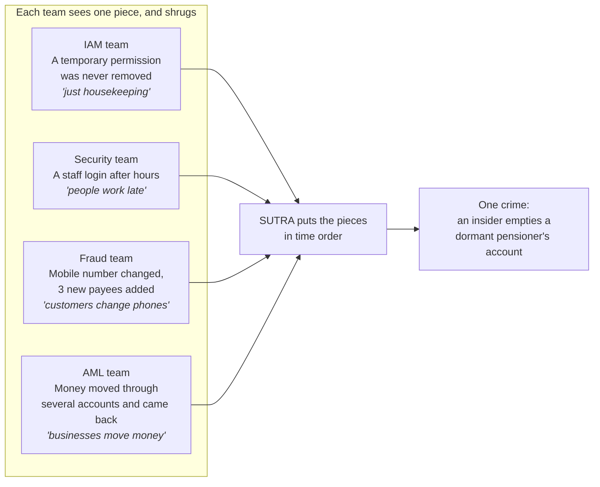

**The flagship example (pretend):** an operations officer uses a forgotten "override" permission after
hours to take over a pensioner's unused account. **₹14.7 lakh** leaves **47 minutes** after the first
login. The permission that made it possible was given **9.5 days** earlier.

Two more things make this hard:

- **False alarms.** A pension camp, month-end overtime or salary day create the *same* raw events as
  fraud. A simple detector would bury investigators in noise.
- **Explaining yourself.** A bank must justify an accusation to the employee, a regulator and maybe a
  court. "The computer said 0.93" is not good enough.

**In one line:** each team sees one footprint; SUTRA follows the whole trail from *who got access* to
*where the money went*, and at every step first asks *"is there an innocent reason for this?"*

---

## 2. What SUTRA is

Think of SUTRA as a **detective's workbench**. It collects the records, builds the story in order,
argues for *and* against suspicion, ranks what to look at first, lets AI "experts" debate it, and
leaves the final decision to two humans.

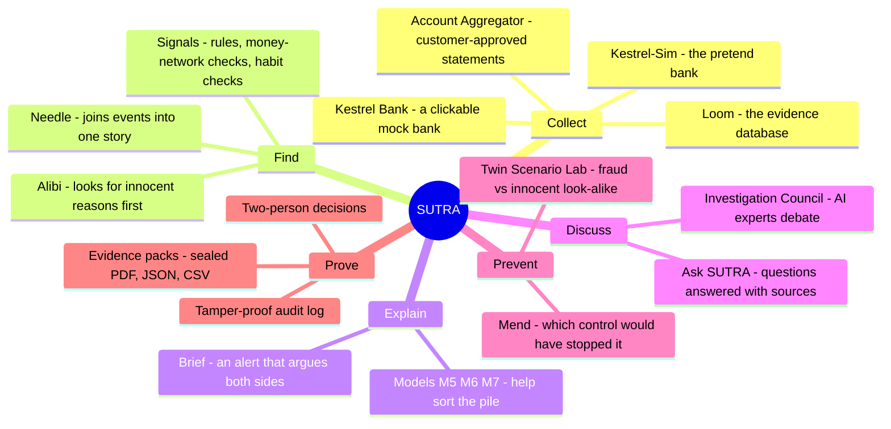

| Part | What it does, simply |
|---|---|
| **Loom** | The filing cabinet. Every record remembers *when it happened* and *when we found out*. |
| **Alibi** | The defence lawyer. For every staff action it asks: was there a ticket? their customer? on shift? |
| **Signals** | Small red flags: 10 rules (R1–R10), 5 money-network checks (G1–G5), 2 habit checks (M1, M2). |
| **Needle** | The bead-stringer. Joins red flags into one story in time order, ending in money leaving. |
| **Brief** | Turns a story into a short legal-style memo: what happened, proof, counter-arguments, priority. |
| **Models** | Small, explainable helpers (M5, M6, M7) that help decide what to look at first. |
| **Investigation Council** | 8 AI "experts" and a chairperson debate the case. |
| **Ask SUTRA** | Ask a question, get an answer where every sentence points to its proof. |
| **Mend** | "Which rule change would have stopped this, and what would it cost honest staff?" |
| **Twin Scenario Lab** | Every fraud has an innocent twin. SUTRA must flag one and stay quiet on the other. |
| **Evidence packs** | 11-section PDF + JSON + CSV, sealed with a fingerprint so nobody can alter it. |
| **Governance** | Staff names hidden, two people needed to reveal a name or decide a case, tamper-proof log. |
| **Live Ops** | Streams new records in live and runs the real detection in front of you. |
| **Kestrel Bank** | A working fake bank; every click becomes evidence. |
| **Account Aggregator** | India's consent-based way to share bank statements, shown on a labelled fake provider. |

---

## 3. The big picture: system architecture

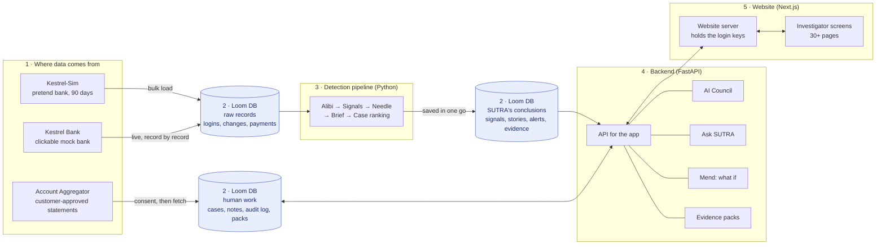

**Reading it left to right:**

1. **Data comes in** from the pretend bank, the mock bank, or customer-approved statements.
2. **Everything is stored in one database** (PostgreSQL, called Loom). The three blue cylinders are
   the same database: raw records, SUTRA's conclusions, and the humans' work, side by side, so
   nothing drifts out of sync.
3. **The detection pipeline** reads the raw records and writes suspicious stories back.
4. **The backend** serves the app and runs the extra tools: Council, Ask SUTRA, Mend, evidence packs.
5. **The website** shows it all. Its own server holds the login keys, so the browser never does.

### How the backend code is organised

One program, with clearly separated "rooms". Only the `api/` room knows about the web. That is why the
same detection code can run from the command line, from tests, on a timer, or live on screen.

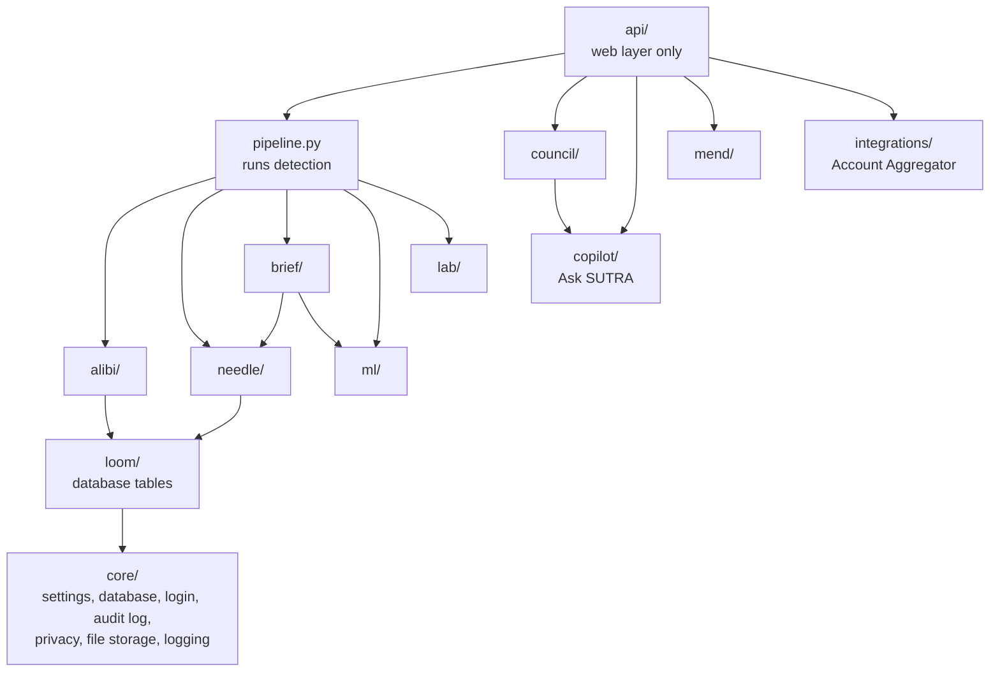

---

## 4. Night shift and day shift

SUTRA has two loops.

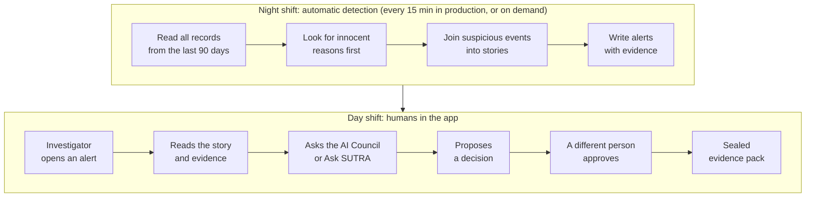

- **Night shift (detection loop):** reads the whole 90-day window, runs every step, and saves the
  results in one go. Running it twice is always safe; you get the same answer.
- **Day shift (investigation loop):** a person reads the stories, questions them, and decides, with a
  second person approving.

---

## 5. The detection workflow, step by step

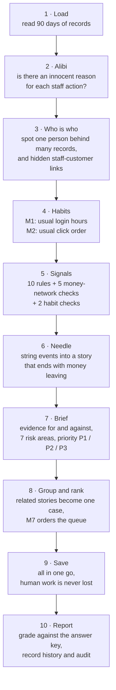

| Step | In simple words |
|---|---|
| **1. Load** | Read 14 tables into memory, always in the same order, so the result never depends on the order records arrived. |
| **2. Alibi** | For every staff action, look for 5 kinds of innocent reason (see [section 7](#7-how-sutra-avoids-false-alarms)). About **98%** of actions are cleared here. |
| **3. Who is who** | Find one person hiding behind several customer records (same phone, similar name or birthday). Find staff who secretly live at a customer's address. Each match says *why* it matched. |
| **4. Habits** | **M1:** "Does this person normally log in at this hour?" (compared gently with colleagues, so new staff aren't flagged for being new). **M2:** "Is the order of screens they clicked normal for their job?" |
| **5. Signals** | Rules catch known patterns ("seven cash deposits just under ₹50,000"). Graph checks catch shapes in the money network ("money went round in a circle"). |
| **6. Needle** | Joins signals into a story. **Key rule: a story only becomes an alert if it ends with money leaving.** Each step must happen within 72 hours of the last. |
| **7. Brief** | Writes the argued alert: 7 risk areas, graded evidence, counter-arguments, and a plain-English priority rule. |
| **8. Group and rank** | Stories that share an account, customer, device or person become one **case**. M7 decides the order within a priority level. |
| **9. Save** | Swap in the new results in one go. Open cases, notes and packs that humans created are kept. Readers see the old results until the new ones are fully saved. |
| **10. Report** | Grade itself against the answer key (demo: **14/14** checks passed, **8/8** innocent twins stayed quiet), save a history entry for every changed alert, and write to the audit log. |

A full run takes about **23 seconds on a laptop** (about 80 seconds in the audit environment).

### The rules and graph checks at a glance

| Code | Catches | In plain words |
|---|---|---|
| R1 | Cash structuring | 3+ cash deposits of ₹45,000–49,999 within 72 h, across accounts or branches |
| R2 | Limit-hugging | 2+ transfers at 95%+ of the limit within 30 min |
| R3 | Dormant reactivation | First withdrawal after 2+ years of no activity |
| R4 | Contact change → payee → payout | Phone or password changed, new payee, payment to them, all within 24 h |
| R5 | Off-shift access | Sensitive action outside the person's shift |
| R6 | Access without purpose | Sensitive action with no ticket, customer or task behind it |
| R7 | Override use | A change made using an "override" permission |
| R8 | Too much power in one person | Dangerous mix of permissions, or someone approving their own KYC |
| R9 | Expired permission used | Override used after it was supposed to expire |
| R10 | No customer present | Account opened with no branch visit or fingerprint check |
| G1 | Money circles | Money goes round up to 6 accounts and mostly comes back, within 72 h |
| G2 | Pass-through | 90%+ of incoming money leaves within an hour |
| G3 | Fan-in / fan-out | 12+ different counterparties within 48 h |
| G4 | Mule factory | One employee suddenly approving many accounts that share phones or devices |
| G5 | Shared identifier | One phone or device used by 3+ customers, or an undeclared staff–customer link |

---

## 6. The flagship case as a story

This is the chain that Needle builds for the main demo case. Colours show which team would normally
see that piece on its own.

```mermaid
flowchart LR
  E0["E0 · 9.5 days before<br/>Temporary override<br/>given, never removed"] --> E1["E1 · After hours<br/>Officer logs in<br/>over VPN"]
  E1 --> E2["E2<br/>Opens a dormant<br/>pensioner's account<br/>0 of 5 innocent reasons"]
  E2 --> E3["E3<br/>Changes the mobile number<br/>using the override,<br/>raises the limit"]
  E3 --> E4["E4<br/>3 new payees<br/>from a never-seen phone"]
  E4 --> E5["E5 · 47 min after login<br/>₹14.7 lakh sent out"]
  E5 --> E5b["E5′<br/>Money forwarded<br/>and cashed out"]
  E5b --> E6["E6<br/>Money loops back"]

  classDef iam fill:#e8eefc,stroke:#4a5fc1,color:#1b2a6b
  classDef soc fill:#fdf1e3,stroke:#d9822b,color:#6b3a07
  classDef fraud fill:#fde8e8,stroke:#c0392b,color:#6b1111
  classDef aml fill:#e6f6ee,stroke:#2e8b57,color:#114a2b
  class E0 iam
  class E1,E2 soc
  class E3,E4,E5 fraud
  class E5b,E6 aml
```

Legend: blue = IAM, orange = Security (SOC), red = Fraud, green = AML.

**What the investigator sees:**

- **Priority:** P1, because 3+ risk areas are HIGH, the proof comes from 2+ separate systems, there is
  no alibi, and the money can still be recovered.
- **Counter-arguments checked:** "the customer asked for it": *refuted*. "Authorised extra duty":
  *refuted*. "Someone stole the officer's password": *still open* (needs IT forensics).
- **Mend says:** "Expire temporary permissions automatically" would have broken the chain at E0,
  about a week before the money moved.
- **Council says:** the chain and money flow are proven by records; *who* did it is contested until
  computer logs are checked. The disagreement is recorded and it goes to human review.

---

## 7. How SUTRA avoids false alarms

Three layers of protection:

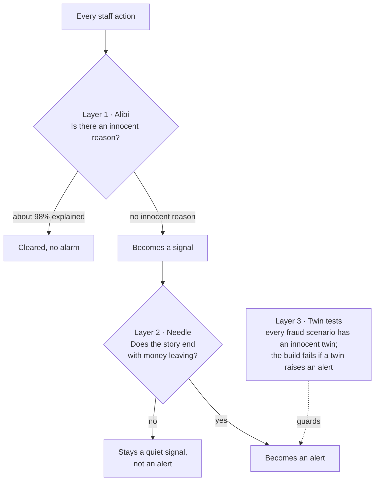

### Alibi: playing defence lawyer for every action

Alibi checks five kinds of innocent reason. Four are about **purpose**, one is about **timing**.

| Check | Passes when... | Type |
|---|---|---|
| Ticket | A service ticket for this customer exists in the 72 h before, and its text matches the action | Purpose |
| Portfolio | This employee is the customer's relationship manager | Purpose |
| Queue | A work item for this account was assigned to them (within 7 days) | Purpose |
| Interaction | The customer was physically at the branch (token or fingerprint eKYC within 45 min), or called in within 24 h | Purpose |
| Roster | The action happened during their scheduled shift (30 min grace) | Timing |

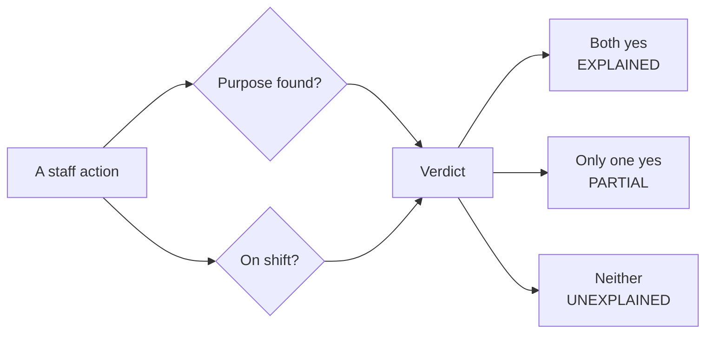

Every check is saved, including the ones that failed and why. The investigator sees "no ticket in the
72 hours before", not just "unexplained".

### Scenario twins (the built-in exam)

| # | Suspicious scenario | Its innocent twin differs by... |
|---|---|---|
| S1 | Normal bank activity | (the control group) |
| S2 | ₹8 lakh goes round 4 accounts in under 48 h | Same loop happens monthly, with invoices, between old partners |
| S3 | 7 cash deposits just under ₹50,000 across 3 branches | One account, one branch, the same pattern for months |
| S4 | Insider takes over a dormant account | A ticket, fingerprint check and camp roster explain it |
| S5 | Hidden employee–customer relationship | The relationship was declared |
| S6 | Outsider takes over an account at 02:14 | Same city, no password reset, no new payees |
| S7 | 11 mule accounts opened by one employee | Institution account, no shared devices, no cash-out |
| S8 | Salary day, festival spending, month-end overtime | (all innocent, a stress test) |

---

## 8. How priority is decided

SUTRA never gives a single "fraud score". Instead, each alert gets **7 risk areas**, each rated
NONE, LOW, ELEVATED or HIGH, with the evidence for and against:

**Transaction · Employee behaviour · Access · Network · Timing · Relationship · History**

Then a set of **readable rules** (the "lattice") sets the priority:

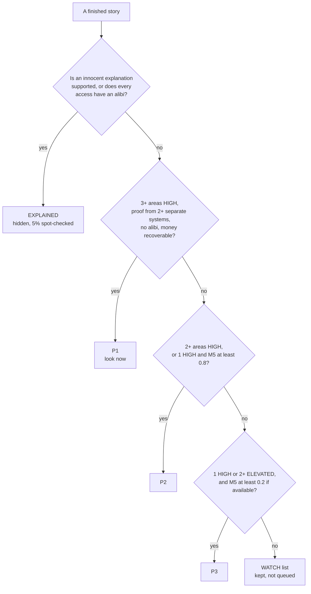

The exact sentence that set the priority is saved on the alert, for example: *"3 dimensions High
(Transaction, Access, Temporal), evidenced by 4 independent systems, no alibi, funds still
recoverable → P1"*. The model M5 can only move a story between WATCH and the queue; it can **never**
create a P1 by itself.

### How trustworthy is each piece of evidence?

Every piece of evidence gets two grades, borrowed from intelligence agencies:

| Source grade | | Information grade | |
|---|---|---|---|
| **A** | Official bank record | **1** | Confirmed by another system |
| **B** | Operational log | **2** | Consistent, not yet confirmed |
| **C** | Worked out by a SUTRA model | **3** | Not confirmed |
| **D** | Pulled out by an AI language model | **4** | Contradicted |

### The alert reads like a legal memo

The alert follows a classic argument structure (the Toulmin model): **the claim**, **the proof**,
**why that proof supports the claim**, **the regulations behind it**, **how sure we are**, and
**the counter-arguments**, plus what evidence is missing and what to do next.

---

## 9. The machine-learning models

The models are **small, explainable helpers. They never decide on their own.** Each number comes
with a breakdown of why, pointing back to the actual records.

| Model | Looks at | Question it answers | Limit |
|---|---|---|---|
| **M1** | A staff login | "Does this person usually log in at this hour?" | Supporting evidence only |
| **M2** | A staff login | "Is this click order normal for their job?" | Supporting evidence only |
| **M5** | A story (chain) | "How much does this look like fraud?" | Can only move a story between WATCH and the queue |
| **M6** | An account | "Does this account behave like a mule?" | Can't carry a case alone |
| **M7** | A connected case | "Which case should we look at first?" | Orders the queue within a priority level; never sets priority, never closes a case |

**Why simple models?** A bank must justify every alert. The chosen models (logistic regression and
LightGBM) give an *exact* breakdown of each score. Neural networks wouldn't do better on this kind of
small table data, and they can't be explained as exactly. Scores are shown between 0.01 and 0.99:
*"a reason to look first, never certainty."*

### Honest training and testing

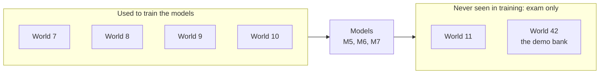

Each "world" is a completely separate pretend bank. Related records (a takeover and the mule ring it
pays into) are always kept together when testing, so the model can't cheat by recognising them.

### Results (on pretend data, say so every time)

On the unseen worlds (707 cases: 33 suspicious, 166 innocent look-alikes):

| Method | Of the cases it flagged, how many were real? | Of the real ones, how many did it find? | Innocent look-alikes flagged |
|---|---|---|---|
| Simple bank rules (RB-1) | 42% | 91% | 16% |
| SUTRA with models off (RB-2) | 24% | 76% | 4% |
| **SUTRA with M7** | **100%** | **97%** | **0%** |
| M7 without detector inputs | 91% | 88% | 1% |

**Honest caveats:** simple rules still win in places (they catch every money circle; M7 misses one
loop in the demo world, which stays P2), the number of real fraud cases is small, and none of this
says anything about accuracy at a real bank.

### How a model gets approved

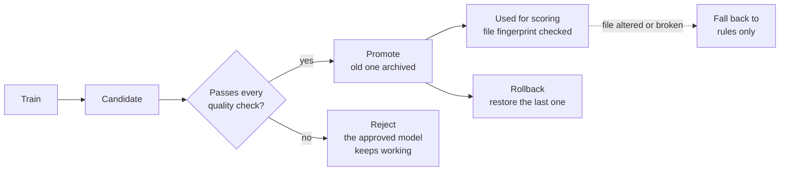

Quality checks include: minimum accuracy, no big drop versus the current model, no reliance on a
single feature, and no exam worlds used in training. Models are **never** retrained automatically.

---

## 10. The AI parts, and how they are kept in check

**The golden rule: AI language models only write. They never find, score, prioritise or close an
alert.** Everything they write is checked against the evidence before anyone sees it.

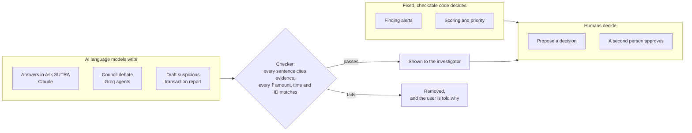

**Why?** If AI did the detecting, results would change from run to run, couldn't be explained, and a
crafty insider could write "ignore previous instructions" into a ticket to trick it. Without any AI
key, backup engines produce the same structure, so SUTRA works fully offline.

### Ask SUTRA: answers with receipts

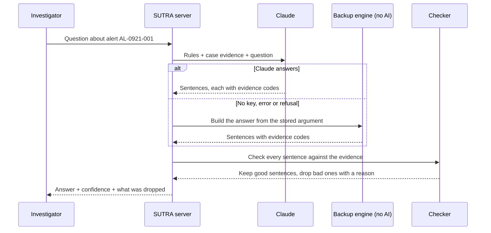

The checker (**"cite-or-drop"**) keeps a sentence only if it cites evidence, every cited code exists,
and every ₹ amount, time and ID it mentions really appears in that evidence. Dropped sentences are
shown, not hidden. Ask SUTRA can also draft a Suspicious Transaction Report where every line is cited.
AI writing is **off in production** until the AI can run inside India.

### The Investigation Council: a panel of AI experts

| Expert | Side | Job |
|---|---|---|
| Chain Analyst | Prosecution | Rebuild the story: permission → access → change → payment → mule → cash-out |
| Money Trail | Prosecution | Follow the money |
| Insider Risk | Prosecution | Look for misuse of power and odd behaviour |
| Alibi | Neutral | Look for innocent reasons |
| Defence | Defence | Try to prove it's innocent |
| Prosecution | Prosecution | Build the strongest evidence-backed story |
| Control | Neutral | Find which safety rule failed |
| Evidence | Neutral | Judge evidence quality, contradictions and gaps |
| Moderator | Neutral | Run the rounds, record agreement and disagreement |

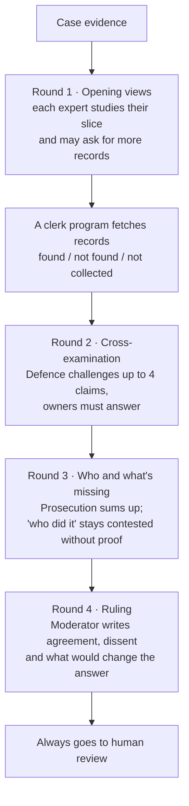

Every claim ends with a status: **SUPPORTED**, **CONTESTED**, **UNEXPLAINED**, **MISSING** or
**CONTRADICTORY**. There is no confidence score.

### The supervisor program (the "harness")

When real AI agents run the council (on Groq), every AI call goes through a strict supervisor.
In simple words:

- **Fill in the form:** agents must answer in a fixed format and can only use evidence IDs they were
  given. One retry is allowed if the format is wrong.
- **Show your source:** a claim citing an unknown ID is thrown out, not fixed.
- **Proof levels:** "SUPPORTED" needs at least one official (A/B grade) record.
- **No accusations:** sentences saying a person committed wrongdoing are removed. "Who did it" is
  always CONTESTED, because device logs and CCTV aren't collected.
- **Clerk fetches files:** agents can ask for records only from their allowed list; the program fetches them.
- **Fixed budget:** at most 24 calls, 120,000 tokens and 240 seconds per investigation. If it runs
  out, it stops and says so.
- **No loops:** repeated identical calls are served from cache; a third repeat is refused.
- **Bank records are data, not commands:** records are clearly labelled "untrusted", so text inside
  them can't give the AI orders.
- **Full log:** every AI call is recorded (what it saw, what it said, what was dropped and why).
- **Backup:** if an agent fails, the non-AI version of that part is used. If all fail, the whole
  council runs without AI and is labelled as a fallback.
- **Honest coverage:** if not all evidence was reviewed, the outcome starts with "Partial review".

> **Status:** the non-AI council and Ask SUTRA's backup path run in the demo. The Groq agent path is
> fully built and tested with a scripted fake model (20 tests), but hasn't had a live Groq run yet
> (no key). Say: *"LLM agents on Groq when a key is configured; tested with a scripted model here."*

---

## 11. Mend: the "what if" machine

For a fraud story, Mend asks: **which safety rule would have stopped it, how early, how much money it
would have saved, and how often it would have bothered honest staff in the last 90 days.**

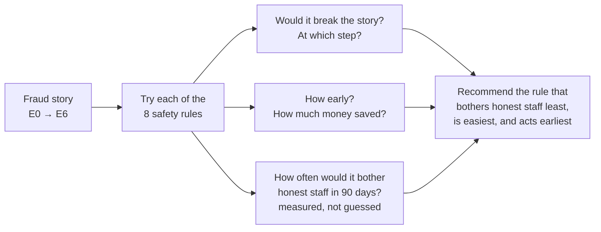

| ID | Safety rule | Stops the story at | Effort |
|---|---|---|---|
| C1 | Temporary permissions expire automatically | E0 | Low |
| C2 | A second person checks mobile-number changes | E3 | Medium |
| C3 | No mobile override without a fingerprint check | E3 | Low |
| C4 | Extra approval for after-hours actions | E3 | Medium |
| C5 | 24 h wait for new payees after a contact change | E5 | Medium |
| C6 | Reactivating a dormant account needs a branch visit | E5 | Low |
| C7 | Raised limits only work after 12 h | E5 | Low |
| C8 | The person opening an account can't approve its KYC | F1 | Low |

For the flagship case, **C1** wins: the override would have expired 2 days after it was given, about a
week before the money moved.

---

## 12. Live demo, mock bank and Account Aggregator

### Live Ops: detection happening in front of you

Nothing is pre-computed. The pretend bank holds back one evening (22 Sep): **247 records from 11 bank
systems**. Hidden inside: a second insider takeover, and an innocent pension camp making the *same*
kind of mobile-number changes.

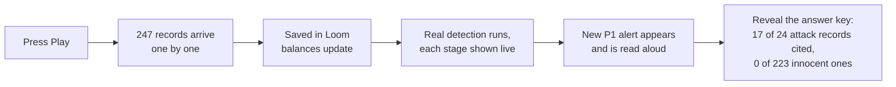

- **"Your input"** lets a judge play the insider: pick who logs in, when, what paperwork exists, what
  changes, where the money goes. SUTRA answers P1, P2 or "no alert", with reasons. "Undo" removes it
  exactly.
- **Reset** removes every added record exactly and re-runs detection.

### Records arriving late, twice, or jumbled

Real bank feeds can send the same record twice and in any order. Every delivery gets a **receipt**:

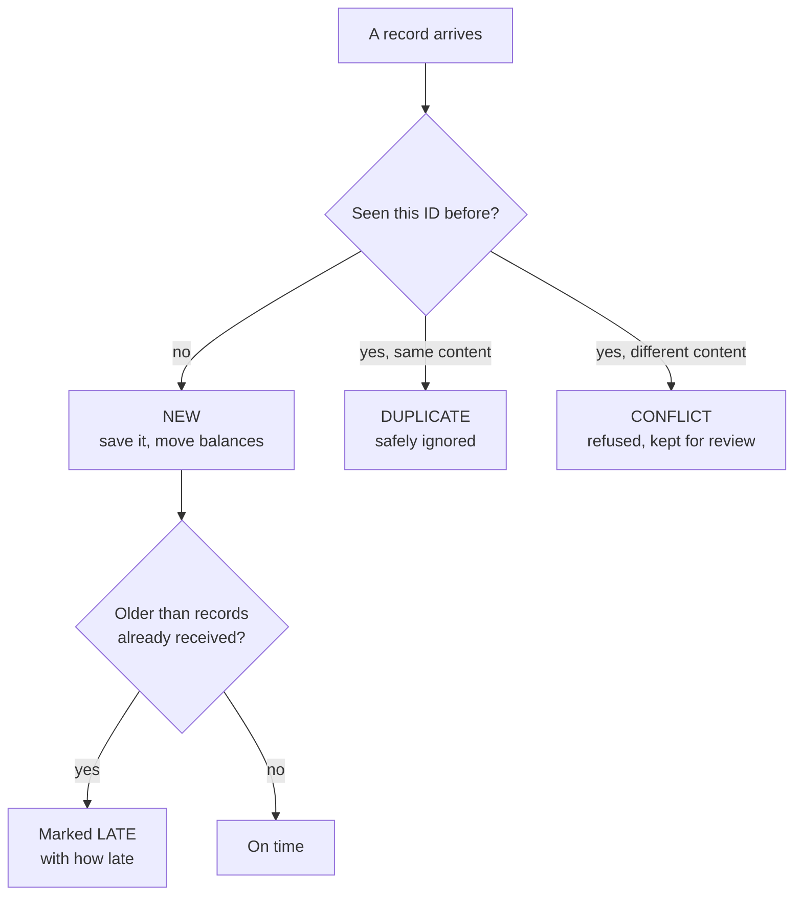

We replayed the evening in **5 different arrival orders** (in order, one feed 35 min late, 30%
duplicates with one tampered amount, shuffled, reversed). Every order ended with **identical results
on all 85 cases.** Whatever order records arrive in, SUTRA reaches the same conclusions.

### Kestrel Bank: a working mock bank

A fake bank you can click through: a **staff console** (sign in from branch or VPN, search customers,
change mobile numbers and limits, raise tickets, do eKYC) and **customer NetBanking** (sign in, reset
password, add payees, send money). It enforces real rules (permissions, balances, limits) and every
action lands in Loom immediately. It has 10 one-click test scenarios.

### Account Aggregator: customer-approved bank statements

India's RBI-regulated system for sharing bank statements with the customer's permission.

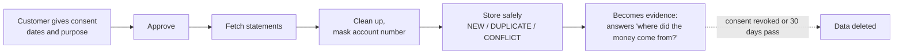

Works today on a clearly labelled **fake provider**. The Setu sandbox adapter is written but not yet
tried (needs credentials). These statements are **not** fed into the models.

---

## 13. The pretend bank (our data)

**Kestrel-Sim** generates a fictional co-operative bank, **Kestrel Urban Co-operative Bank**, with 3
branches (Kothrud and Hadapsar in Pune, Nashik Road in Nashik), and 90 days of:

- **Staff:** branch managers, officers, tellers, relationship managers, KYC approvers, IT admin, their
  permissions (including temporary overrides) and shift rosters.
- **Customers:** accounts, devices, logins.
- **Activity:** staff actions, account changes, payees, payments (UPI, IMPS, NEFT, RTGS, cash, ATM),
  tickets, eKYC, calls.
- **Answer key:** which records belong to which crime, and what SUTRA *should* conclude.

Sizes: tiny = 900 customers, demo = 3,600, full = 12,000. The same seed always produces the exact same
bank. On purpose, it includes awkward-but-innocent behaviour (overtime, salary day, vague tickets,
curiosity look-ups) to trip up naive detectors.

**Why pretend data?** No privacy risk, we know the right answer for every case, and we can create as
many separate banks as we need for fair testing. Public fraud datasets have no staff or permission data
at all, and real bank data can't legally be used in a hackathon. Phone and ID numbers are scrambled
before they're ever saved.

---

## 14. The database

**Loom** is one PostgreSQL database: one well-organised filing cabinet. The suspicious stories are
stored right next to the records they cite, so nothing can drift out of sync.

### Main tables and how they connect

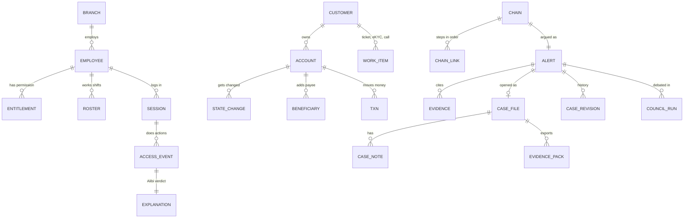

| Group | What's in it |
|---|---|
| Staff and organisation | Branches, employees, permissions, shift rosters |
| Customers and activity | Customers, accounts, devices, logins, actions, changes, payees, payments, tickets: the raw evidence |
| SUTRA's conclusions | Signals, Alibi verdicts, stories, alerts, evidence, model scores |
| Human work | Cases, notes, evidence packs (never deleted by a detection re-run) |
| Platform | Users, name-reveal requests, tamper-proof audit log, answer key |
| Live feed | Held-back records and a receipt for every delivery |
| Newer additions | Case history (can only be added to), saved council runs, Account Aggregator data |

### Design choices in plain words

- **Two clocks on every record:** *when it happened* and *when SUTRA learned about it*. An auditor can
  ask "what did we know at 21:46?"
- **Readable IDs** like `EMP-0417`, `A-5520`, `AL-0921-001`, because investigators read them.
- **Money stored in paise** (whole numbers), so there are no rounding errors.
- **Times stored in UTC**, shown in Indian time.
- **Case history can't be edited or deleted**; the database itself refuses.

**Why not a graph database?** The data *is* a network (people → accounts → money), but events, evidence,
cases and the audit log must all be saved together safely in one go. A bank's 90-day network fits in
memory, and one database means one backup and one thing to secure.

---

## 15. The backend

One Python program (**FastAPI**) with separate rooms, serving **14 groups of web addresses** under
`/api/v1`: login, overview, alerts, cases, graphs, entity search, intelligence, workbench (Mend,
Council, Lab, Ask SUTRA), evidence packs, governance, live streaming, Live Ops, mock bank and Account
Aggregator.

- **Safety on startup:** in staging or production, the server **refuses to start** if secrets are
  default or too short, demo mode is on, or evidence storage isn't locked. A mistake fails the
  deployment instead of failing an audit months later.
- **Health checks:** "am I alive?" never touches the database (so a database blip doesn't restart
  everything); "am I ready?" checks the database and the models.
- **Rate limit:** 600 requests per minute per client.
- **Long jobs** (Live Ops runs, Council runs) run in the background and stream progress live to the
  browser. If the connection drops, the browser picks up where it left off. No extra queue system is
  needed.

---

## 16. The website and login safety

**Next.js** (React) builds the investigator screens. Its own server acts as a **middleman (BFF:
Backend-for-Frontend)**, so the browser **never** holds the login keys.

```mermaid
sequenceDiagram
  participant B as Browser
  participant W as Website server (BFF)
  participant A as SUTRA API
  B->>W: Sign in with username and password
  W->>A: Check the login
  A-->>W: Access key (15 min) + refresh key (12 h)
  W-->>B: Locked cookie that page scripts cannot read
  B->>W: Show me the alerts (cookie sent automatically)
  W->>A: Get alerts, with the access key attached
  alt Access key expired
    W->>A: Refresh the key
    A-->>W: New keys
    W->>A: Try again
  end
  A-->>W: Data
  W-->>B: Data
```

**Why:** if a bad script ever got into the page, it still couldn't steal a login key. Everything is on
one web address, so strict browser security rules can be used, and the API isn't exposed to the
internet.

### The screens

| Area | Screens |
|---|---|
| Home | Command Center (overview, queue, numbers), Live Ops |
| Investigate | Cases, Signal Desk, Chain Explorer, Money Trail, Entity Explorer |
| Intelligence | Alibi Ledger, Risk Network, Mule Factory, Timeline Replay |
| Council | Investigation Council with voice, rounds and a full log |
| Evidence | Evidence packs, prosecution vs defence, missing evidence, audit trail |
| Prevent | Control Lab, Control Library, Twin Scenario Lab |
| Governance | Users and roles, registry, name-reveal approvals, data sources, AI policy |
| Mock bank | Kestrel Bank staff console and NetBanking |

**Colour has meaning, never decoration:** coral = suspicious / money at risk, amber = uncertain,
mint = explained / verified, orchid = AI output, periwinkle = links and neutral info. The Council can
speak aloud using the browser's built-in voice, which works offline, so no case text leaves the computer.

---

## 17. Security: nobody acts alone

**In one line:** deciding a case takes two people, revealing an employee's name takes two people,
every action goes into a log that shows tampering, and personal numbers are scrambled before they're
stored.

### Two-person decisions ("four-eyes")

```mermaid
flowchart LR
  A["Assigned investigator<br/>proposes a decision"] --> B{"Is the reviewer<br/>a different person?"}
  B -->|"yes"| C["Decision approved"]
  B -->|"no"| D["Blocked by the server"]
  C --> LOG["Written to the<br/>tamper-proof log"]
```

### Revealing an employee's name

```mermaid
flowchart LR
  H["Staff shown only as<br/>role + branch + ID"] --> R["Investigator requests the name<br/>with a written reason"]
  R --> AP{"Approved by a<br/>different person?"}
  AP -->|"yes"| SHOWN["Name visible<br/>for 4 hours"]
  AP -->|"no"| HIDDEN["Stays hidden"]
  SHOWN --> EXP["Expires automatically"]
```

### The tamper-proof audit log

Each log entry includes a fingerprint of the entry before it, like links in a chain. Change any old
entry and every link after it breaks, and the checker reports the first broken link.

```mermaid
flowchart LR
  L1["Entry 1<br/>fingerprint 1"] --> L2["Entry 2<br/>fingerprint of entry 1<br/>+ its own data"]
  L2 --> L3["Entry 3<br/>fingerprint of entry 2<br/>+ its own data"]
  L3 --> L4["..."]
```

### Other protections

| Protection | In simple words |
|---|---|
| Passwords | Stored scrambled (bcrypt); short-lived login keys |
| Roles | 8 roles, each allowed only specific actions, checked on every request |
| Personal numbers | Phone and ID numbers turned into keyed fingerprints at entry; can be compared, never read back; phones shown as +91 ••••• 1234 |
| Evidence | Every item fingerprinted; packs sealed with a checkable list of fingerprints; stored in a locker that can't be changed for 5 years |
| Secrets | Never in Git, never logged |
| Models | Altered model files are refused; SUTRA falls back to rules |
| Data location | Mumbai main region, Hyderabad backup, as RBI requires |

### Who can do what

| Role | Demo user | Can |
|---|---|---|
| L1 Analyst | rohit | Read, triage |
| L2 Investigator | ananya | Investigate, propose, build packs, use Ask SUTRA and Mend, request a name |
| Vigilance (CVO) | suresh | Review and decide, lock packs, approve name reveals |
| Principal Officer (PMLA) | farah | Decide, draft STR, approve name reveals |
| Insider-Risk Lead | karthik | Review alibis, request a name |
| Team Lead | meera | Assign, review, decide |
| Auditor | audit | Read everything, including the audit trail |
| Admin | admin | Governance, approve name reveals, run detection |

---

## 18. Running it: local, cloud and releases

> **Status:** the Docker setup runs locally. The Kubernetes and AWS setups are written and checked
> automatically, but this repository does not show a live AWS deployment.

### On one machine (docker compose)

```mermaid
flowchart LR
  PG["PostgreSQL<br/>ready"] --> MIG["Migrate<br/>create tables"]
  MIG --> SEED["Seed<br/>build pretend bank<br/>+ run detection"]
  SEED --> API["API<br/>ready"]
  API --> WEB["Website"]
  VK["Valkey<br/>shared counter"] --> API
```

Containers run as non-root, read-only, with all extra powers dropped. The API image even **trains the
models during the build**, so no model files are stored in Git.

### In the cloud (AWS design)

```mermaid
flowchart TB
  USER["Investigator's browser"] --> WAF["AWS WAF<br/>web firewall"]
  WAF --> ALB["Load balancer"]
  subgraph MUM["Mumbai region (ap-south-1), private network over 3 zones"]
    subgraph EKS["Kubernetes cluster (EKS)"]
      WEBP["Website<br/>Next.js"]
      APIP["API<br/>FastAPI"]
      CRON["Detection job<br/>every 15 min"]
    end
    RDS[("PostgreSQL (RDS)<br/>copies in 2 zones")]
    VAL[("Valkey<br/>shared counters")]
    S3[("S3 evidence locker<br/>locked for 5 years")]
  end
  ALB --> WEBP
  WEBP --> APIP
  APIP --> RDS
  CRON --> RDS
  APIP --> VAL
  APIP --> S3
  RDS -.->|"backup copy"| DR["Hyderabad (ap-south-2)<br/>disaster recovery"]
  S3 -.->|"copy"| DR
```

- Only the website can talk to the API, and only the API can talk to the data stores.
- Separate encryption keys for data, evidence and backup.
- No stored AWS passwords: GitHub proves its identity to AWS directly.
- Only images signed by our own release pipeline are allowed to run.

### How code ships safely

```mermaid
flowchart LR
  PR["Code change<br/>pull request"] --> CI["Checks<br/>lint, real detection on real Postgres,<br/>tests, website build,<br/>Kubernetes and AWS checks,<br/>security scans"]
  CI --> REL["Release<br/>build once, sign it,<br/>parts list, proof of origin"]
  REL --> STG["Staging<br/>deployed automatically"]
  STG --> PROD["Production<br/>manual approval,<br/>10% → 50% → 100% rollout"]
```

**In one line:** it's built to run the way a bank needs: in India, with no passwords lying around,
with signed and scanned software, and every production change made through a reviewed Git commit.

---

## 19. Testing

16 test files, about 180 test cases. Latest full run: **177 passed, 2 skipped, 0 failed.**

| Tests | What they prove |
|---|---|
| Scenario twins | Each fraud is caught and its innocent twin stays quiet |
| Alibi and priority | Alibi verdicts and priority rules work |
| Models | Accuracy floors, exact explanations, no single-feature reliance, fair test splits |
| Model approval | Candidate → check → promote → reject → rollback; altered files refused |
| Record arrival | NEW / DUPLICATE / CONFLICT, late flags, same result in any order, exact reset |
| AI Council | The supervisor with a fake AI: formats, sources, proof rules, no accusations, budgets, backups |
| AI client and checker | Retries, error handling, cite-or-drop |
| API and platform | Real database, real permissions (two-person rules), audit log, privacy |
| Live Ops, mock bank, AA | Live runs, the fake bank, the consent lifecycle |

**Gap:** no automated tests for the website yet (checked by hand).

---

## 20. End to end: from a raw record to a sealed evidence pack

```mermaid
sequenceDiagram
  autonumber
  participant SRC as Bank systems
  participant DB as Loom database
  participant PL as Detection
  participant AN as Ananya (investigator)
  participant CO as AI Council
  participant SU as Suresh (approver)
  SRC->>DB: New records, each gets a receipt
  PL->>DB: Read 90 days of records
  PL->>PL: Find, join and rank suspicious stories
  PL->>DB: Save alerts and evidence, open cases kept
  AN->>DB: Open alert AL-0921-001 (P1)
  AN->>CO: Ask the council to debate it
  CO-->>AN: Findings, disagreements, missing proof
  AN->>DB: Open a case, add notes, draft STR
  AN->>DB: Propose a decision
  SU->>DB: Review and approve (must be a different person)
  AN->>DB: Build sealed evidence pack (PDF + JSON + CSV)
  Note over DB: Every step goes into the tamper-proof audit log
```

---

## 21. What is done and what is not

| Area | Status |
|---|---|
| Pretend bank, database, Alibi, all rules and graph checks, Needle, Brief, priority rules, all models, evaluation | ✅ Done |
| Ask SUTRA (Claude + backup), non-AI Council, Mend, evidence packs, governance, audit log | ✅ Done |
| Order-proof record arrival with receipts, case history, replay test (5 orders) | ✅ Done |
| Model approval system (check, promote, archive, rollback) | ✅ Done |
| AI client, supervisor, budgets | ✅ Done (tested with a fake AI) |
| Council with real AI agents end to end | 🟡 Partly: no live Groq run yet (no key) |
| Account Aggregator | 🟡 Partly: fake provider works; sandbox needs credentials; live needs a regulated partner |
| Docker, compose, CI | ✅ Done; Kubernetes / AWS checked, not shown deployed |
| Resume a Council run after a server restart | ⏳ Pending |
| Cancel refresh keys on sign-out | ⏳ Pending |
| Watching models for drift over time | ⏳ Pending |
| Permission check on Live Ops (demo-only today) | ⏳ Pending |
| Automated website tests | ⏳ Pending |

**Say it this way when presenting:** *"LLM agents on Groq when a key is configured; tested with a
scripted model here."* · *"The real AA consent flow on a labelled synthetic provider."* · Every number:
*"on synthetic data."*

---

## 22. Trade-offs and what comes next

| What we accepted | Why | Next step |
|---|---|---|
| Re-check everything each run (23–80 s) | Simple, correct, same answer in any order | Move to a streaming system (Kafka/Flink) when sub-minute speed is needed |
| One machine, data in memory | Fits a co-operative bank's 90 days | Polars / DuckDB, TimescaleDB, a graph database if needed |
| Tested on pretend data only | Real data isn't legally available | Quiet "shadow mode" trial with a partner bank |
| Few real fraud examples | Fraud is rare by nature | More worlds; uncertainty ranges already reported |
| Live progress kept in memory | No extra queue system to run | Save Council progress after each round |
| Login keys valid until they expire | Simple; bank SSO in production | Block list for cancelled keys; bank single sign-on |
| AI writing off in production | AI can't yet run inside India | Self-hosted open model in India, or India-hosted Bedrock |
| Rules need upkeep | Readable and auditable | Twin tests catch breakage on every build |
| No drift monitoring | Models are never auto-retrained | Drift report each run; suggest (never auto-deploy) retraining |

---

## 23. Questions judges will ask

**Why not one fraud risk score?**
A score can't be cross-examined. Seven named risk areas, a readable priority rule and a defence column
can. Models only reorder within a priority level.

**How do you avoid false alarms?**
Three layers: Alibi looks for innocent reasons first; Needle only raises stories that end with money
leaving; and twin tests fail the build if an innocent look-alike raises an alert.

**Where is the AI, really?**
(1) Explainable machine learning: M1, M2, M5, M6, M7, record matching, ticket-text matching.
(2) Language models for writing only: Claude for answers and report drafts, Groq agents for the
Council debate, all behind a checker that verifies every citation and figure.

**What stops the AI making things up or being tricked?**
It can only use IDs it was given, every ₹ amount, time and ID is checked against the evidence,
"SUPPORTED" needs an official record, accusations are filtered out, bank records are labelled as
data, budgets are fixed, and there's a non-AI backup. The AI can't change priority or close a case.

**Is it real-time?**
Records come in live, one by one. Detection is a full re-check (23–80 s), every 15 min in production
or on demand. Results are the same whatever order records arrive in.

**Why PostgreSQL and not a graph database?**
Events, evidence, cases and the audit log must be saved together safely in one go; a 90-day network
fits in memory; one database is easier to secure and back up.

**How do you know the models aren't just memorising?**
Trained only on worlds 7–10, tested on unseen worlds 11 and 42 and on later events; related cases are
always kept together during testing; the system refuses any model trained on exam worlds; results are
shown next to simple rules, including where rules win.

**What about privacy?**
Pretend data only; personal numbers scrambled at entry; staff names hidden with two-person, time-limited
reveal; login keys never in the browser; data kept in India.

**Who makes the final call?**
Always humans: an investigator proposes, a different person approves, and both actions are in the
tamper-proof log.

---

## 24. Tech stack cheat sheet

**The three rules behind every choice:** (1) it must be explainable, (2) evidence must be provable,
(3) it runs inside a bank (data in India, no long-lived passwords, everything audited). Where possible
we picked boring, proven tools and asked *"can we explain this to an auditor?"*

| Layer | Tool | Why, in one line |
|---|---|---|
| Backend language | Python 3.12 | One language for both the API and the data science |
| API | FastAPI | Request checks, docs and permissions all come from the same code |
| Shape | One program with separate modules | No network hops or split transactions; enough for a bank's volume |
| Database | PostgreSQL 17 | Events, evidence, cases and audit log saved together safely |
| Database tools | SQLAlchemy 2, psycopg 3, Alembic | Typed tables, fast bulk loading, versioned schema changes |
| Data and ML | pandas, NumPy, NetworkX, scikit-learn, LightGBM, RapidFuzz, SciPy | Processes 300k+ records in seconds with exact explanations |
| AI for answers | Claude (Anthropic API or Amazon Bedrock) | Strong reasoning over evidence, structured output, caching |
| AI for Council | Groq (gpt-oss-120b) | Very fast, strict output format, open model that could later run in India |
| PDFs | ReportLab | No 300 MB browser inside a security-sensitive container |
| Website | Next.js 16, React 19, TypeScript | Screens and the login middleman on one address |
| Data fetching | TanStack Query | Caching and background refresh without boilerplate |
| Styling | Tailwind CSS v4 | Light and dark themes from one set of colours |
| UI parts | Radix UI, cmdk, lucide-react | Accessible dialogs, tabs and a ⌘K command palette |
| Graphs | React Flow | Pan, zoom and custom nodes without hand-building it |
| Animation, charts | Motion, Recharts | Staged sequences and simple charts |
| Voice | Browser speech | Free, offline, no case text leaves the computer |
| Packaging | uv, npm | Fast, exactly reproducible installs |
| Containers | Multi-stage Docker, non-root, distroless | Small attack surface |
| Running in cloud | EKS, Helm, Argo CD, Argo Rollouts, Karpenter | Safe policies, Git-driven deploys, gradual rollouts |
| Cloud setup | Terraform | Reviewable infrastructure changes |
| Monitoring | OpenTelemetry | Trace a request from browser to database, no vendor lock-in |
| Build and security | GitHub Actions, cosign, SBOM, SLSA, Trivy, CodeQL, Checkov, gitleaks | Signed, scanned, provable builds |

---

## 25. Mini glossary

| Term | Simple meaning |
|---|---|
| **ADR** | A short note explaining one design decision (23 of them in `docs/adr/`) |
| **AML** | Anti-Money Laundering |
| **ATO** | Account takeover |
| **Account Aggregator** | India's system for sharing bank statements with the customer's permission |
| **BFF** | A website server that sits between the browser and the API and holds the login keys |
| **Two clocks (bitemporal)** | Saving both when something happened and when we learned about it |
| **Chain / story** | Linked events in time order, ending with money leaving |
| **Cite-or-drop** | Any AI sentence that can't be tied to evidence is removed |
| **Connected case** | Stories and signals joined because they share accounts, customers or devices |
| **Four-eyes** | A decision needs two different people |
| **Fingerprint (SHA-256 hash)** | A short code that changes completely if the content changes even slightly |
| **Lattice** | SUTRA's readable priority rules |
| **Mule account** | An account used to receive and pass on stolen money |
| **Object Lock (WORM)** | Storage that can't be changed or deleted before a set date |
| **PMLA / FIU-IND / STR** | India's anti-money-laundering law / its financial intelligence unit / a suspicious transaction report |
| **Precision / recall** | Of what was flagged, how much was real / of what was real, how much was found |
| **SSE** | A one-way live stream from the server to the browser |
| **Tokenisation (HMAC)** | Swapping a value for a keyed fingerprint so it can be compared but not read |
| **Twin scenario** | An innocent look-alike that differs from a fraud by one fact |

---

*Every record in SUTRA is synthetic. SUTRA is decision support for investigators; it does not accuse
anyone, and every conclusion goes to human review.*
